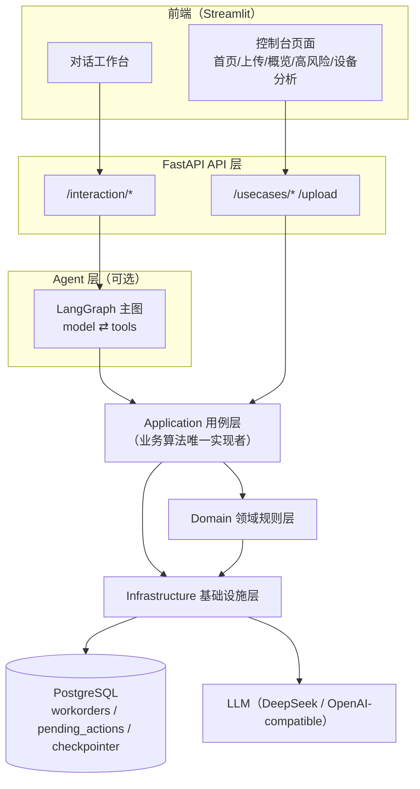
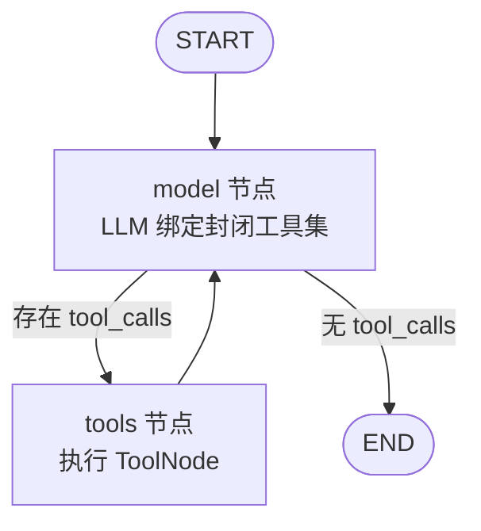
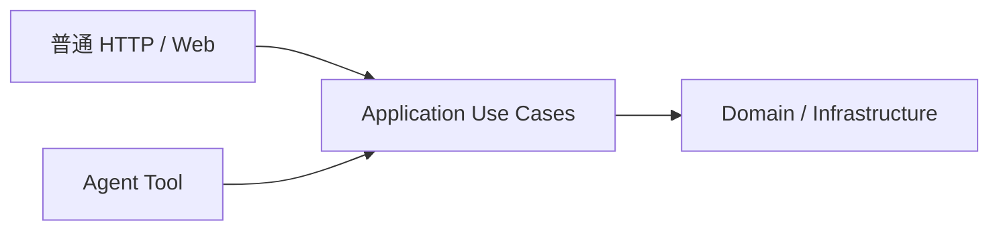
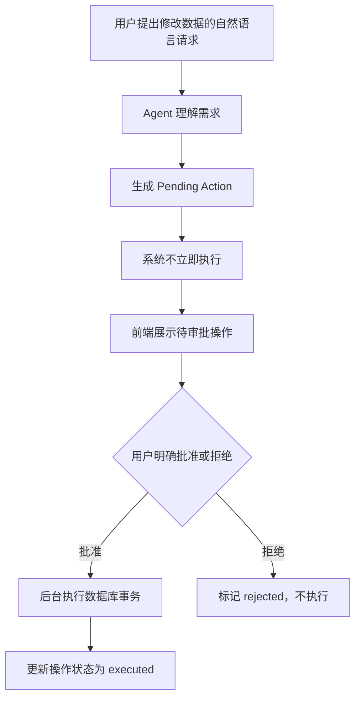
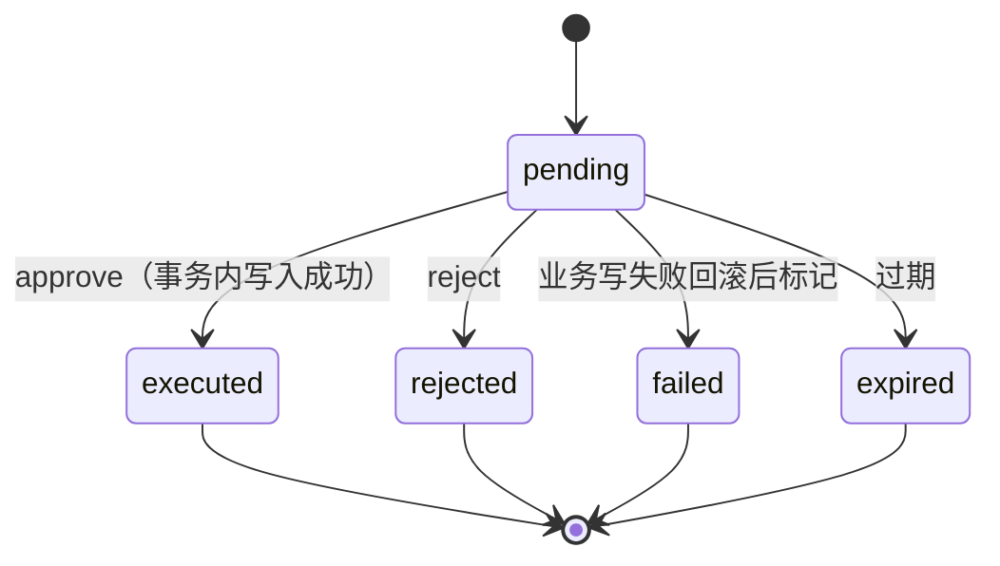
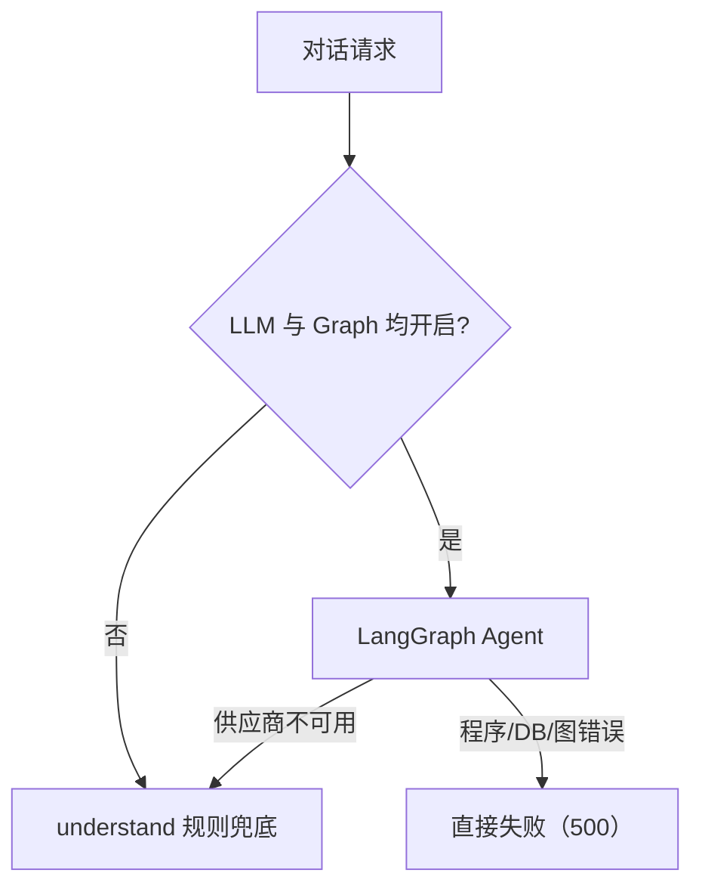
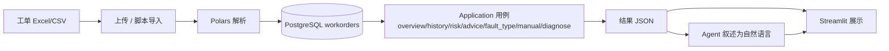

# 《创新应用综合实训》课程报告

## 基于大语言模型与智能体的地铁 AFC 设备智能运维诊断平台

---

| 项目 | 内容 |
|------|------|
| 课程名称 | P402019B《创新应用综合实训》 |
| 项目名称 | 基于大语言模型与智能体的地铁 AFC 设备智能运维诊断平台（AFVC） |
| 学　　院 | 计算机科学与技术学院 |
| 专　　业 | 计算机科学与技术 |
| 班　　级 | 2407 |
| 小组成员 | 曹楠 |
| 学　　号 | 24251311 |
| 指导教师 | 安高云 |
| 日　　期 | 2026 年 8 月 |

---

# 摘要

城市轨道交通 AFC（自动售检票）设备长期高负荷运行，维修工单持续累积，一线运维人员面临工单数据分散、高风险设备难以筛选、维修决策依赖个人经验、知识查询低效、交互方式不友好等痛点。针对上述问题，本项目设计并实现了一套基于大语言模型与智能体的地铁 AFC 设备智能运维诊断平台（AFVC）。系统以 PostgreSQL 为数据真相源、FastAPI 为后端、Streamlit 为前端、Polars 为数据处理引擎，实现了工单导入、数据概览、设备历史、复发风险评估、维修建议、故障类型参考、手册检索与综合诊断等完整能力，并引入 LangGraph 主 Agent 提供自然语言交互入口。Agent 仅负责意图理解与工具编排，业务算法统一由 Application 用例层实现，二者复用同一套能力；系统通过 Human-in-the-Loop 机制约束 Agent 的敏感写操作，结合数据库事务与行锁保证数据安全；同时设计了多层降级策略与科学边界控制，在模型不可用时仍可通过规则兜底提供完整业务能力。项目形成从数据导入、分层业务实现到 Agent 交互与安全执行的完整工程闭环，并以 pytest 单元测试与 CI 保障核心逻辑的可验证性。

**关键词：** AFC 智能运维；大语言模型；智能体（Agent）；Human-in-the-Loop；LangGraph

---

# 项目简要介绍

本项目面向地铁 AFC（自动售检票）设备运维场景，以真实维修工单与设备历史数据为基础，构建了一个将传统数据分析、风险评估、维修知识检索与大语言模型 Agent 相结合的一体化智能运维诊断平台。系统以 PostgreSQL 为数据真相源、FastAPI 为后端、Streamlit 为前端，实现了工单导入、数据概览、设备历史、高风险设备识别、复发风险分析、维修建议、故障类型参考、手册检索与综合诊断等能力，并通过 LangGraph 主 Agent 提供自然语言交互入口。项目的核心设计在于：Agent 只负责理解意图与编排工具，业务算法统一由 Application 用例层实现，二者复用同一套能力；同时引入 Human-in-the-Loop 机制，使 Agent 的敏感写操作必须经人工批准后才执行。系统还设计了多层降级策略与科学边界控制，在模型不可用时仍可通过规则兜底对外提供完整业务能力。

# 成员工作描述及组内量化贡献比

本项目由曹楠一人独立完成，承担需求分析、系统设计、编码实现、测试与文档撰写等全部环节。

- 曹楠：负责需求分析、架构设计、后端（FastAPI + PostgreSQL + Polars）、Agent（LangGraph）、前端（Streamlit）、测试与文档等全部工作

量化贡献比：

- 曹楠：100%

---

# 第1章 项目背景与问题分析

## 1.1 AFC 设备运维场景

AFC（Automatic Fare Collection，自动售检票）系统是城市轨道交通运营的核心子系统，闸机、自动售票机、检票机等设备长期高负荷运行，故障与维修是日常运维的高频工作。每一次设备故障都会产生一条维修工单，工单中记录设备编号、所属车站与线路、故障现象描述、品牌与子系统、故障时间等信息。随着运营年限增长，历史工单不断累积，形成了具有分析价值的数据基础，但这些数据长期处于"存而不挖"的状态，难以直接为一线运维决策服务。

## 1.2 当前问题

围绕 AFC 设备运维的实际工作，可以归纳出以下几类痛点：

1. **工单数量增加后人工查找困难**：一线人员难以在海量历史工单中快速定位某一台设备的全部故障记录。
2. **单设备历史故障信息分散**：同一台设备的故障记录分散在不同时间、不同工单中，缺乏统一的"设备画像"视图。
3. **高风险设备难以快速筛选**：巡检资源有限，如何从众多设备中优先识别复发风险较高的设备缺乏系统化手段。
4. **维修建议依赖个人经验**：面对一条故障现象，维修人员能否给出合理的排查方向，很大程度上取决于个人经验。
5. **手册与维护知识查询效率低**：维修手册内容多、检索方式原始，难以及时命中与当前故障相关的条目。
6. **多种分析能力入口分散**：数据查询、风险分析、知识检索等功能如果彼此割裂，运维人员需要在多个系统间切换。
7. **传统交互方式对自然语言需求支持有限**：一线人员更习惯用自然语言描述"这台设备最近为什么老坏"，而传统系统需要按表单字段操作。

## 1.3 项目目标

AFVC 项目要解决的核心问题是：**如何把分散的维修工单数据、风险评估、维修知识与自然语言交互整合为一个对一线运维友好的统一诊断平台**。具体目标包括：

- 建立工单数据的管理与查询能力（导入、概览、设备历史）；
- 提供可解释的设备复发风险评估与高风险设备排序；
- 提供基于历史现象的维修/巡检建议与手册检索；
- 提供自然语言对话入口，让用户以一句话完成多步骤诊断；
- 在引入大模型 Agent 的同时，通过 Human-in-the-Loop 约束其写操作，保证数据安全。

## 1.4 项目价值

项目的价值体现在以下几个层面，而非单一的量化收益：

- **数据利用**：把沉睡的历史工单转化为可查询、可统计、可分析的结构化资产；
- **信息整合**：把历史、风险、建议、手册等多个分析维度聚合到同一入口；
- **辅助诊断**：为一线运维提供有边界的辅助决策参考，而非替代人工判断；
- **自然语言交互**：降低使用门槛，让非技术背景的运维人员也能直接使用；
- **安全执行**：通过 Human-in-the-Loop 保证大模型不会擅自修改业务数据。

---

# 第2章 需求分析

## 2.1 用户与使用场景

系统面向的主要用户为 AFC 设备运维、巡检、维修人员，以及负责排班调度的值班/调度人员。典型使用场景包括：

- 巡检人员查看高风险设备清单，确定优先巡检对象；
- 维修人员查询某台设备的历史工单与维修建议，辅助现场排查；
- 值班人员通过对话快速了解"当前数据整体情况""哪些设备风险高"等。

## 2.2 功能需求

根据系统的真实实现，功能需求可归纳为以下模块：

| 编号 | 功能 | 说明 |
|------|------|------|
| F1 | 工单数据导入 | 支持上传 Excel/CSV 工单文件并导入数据库 |
| F2 | 数据概览 | 统计工单总数、设备数、站点/线路/品牌分布、时间范围 |
| F3 | 设备历史 | 查询单台设备的全部历史工单 |
| F4 | 高风险设备 | 按风险排序输出优先巡检设备清单 |
| F5 | 风险评估 | 输出设备在多个时间窗口内的复发风险与预警等级 |
| F6 | 维修建议 | 基于历史故障现象生成巡检方向与排查建议 |
| F7 | 故障类型参考 | 基于条件概率给出设备可能出现的故障类别参考 |
| F8 | 手册检索 | 对维护手册进行关键词检索并返回来源 |
| F9 | 综合诊断 | 聚合历史、风险、建议、故障类型形成单设备诊断 |
| F10 | Agent 对话 | 以自然语言完成上述能力的调用与结果叙述 |
| F11 | HITL 数据操作 | 对插入/更新/删除/导入等写操作进行人工审批 |

## 2.3 非功能需求

结合项目实际设计，非功能需求主要体现在：

- **可维护性**：采用分层架构，业务逻辑、领域规则、基础设施边界清晰；
- **安全性**：敏感写操作必须经人工审批，Agent 不具备直接写库能力；
- **可测试性**：用例层不依赖 LLM，可独立单测；
- **数据一致性**：写操作通过数据库事务与行锁保证；
- **可降级性**：模型不可用时系统仍能通过规则兜底提供业务能力；
- **可追溯性**：手册检索结果保留来源，模型轨迹可上报 LangSmith。

> 本项目定位为课程综合实践作品，未涉及百万级并发、分布式集群、超大规模可用性等工程目标。

---

# 第3章 系统总体设计

## 3.1 系统整体架构

AFVC 采用清晰的分层架构，从上到下依次为前端、API 层、Agent 层（可选）、Application 用例层、Domain 领域规则层、Infrastructure 基础设施层。Agent 与传统 HTTP 入口共同复用 Application 用例，Agent 不作为业务算法的第二套实现。



各层职责如下：

| 层 | 职责 | 不负责 |
|----|------|--------|
| 前端（Streamlit） | 展示数据、发起 API 调用、渲染对话与待批卡片 | 业务计算、审批状态机 |
| API 层 | 参数校验、调用 Application/Interaction、错误映射 | 业务计算、审批状态机 |
| Agent 层 | 理解意图、选择工具、编排能力、组织答复 | 业务算法、直接写库 |
| Application 层 | 实现 8 个业务用例与写操作审批编排 | 文件 IO、HTTP、LLM |
| Domain 层 | 预警阈值、概率公式、故障枚举、pending 状态机 | 文件 IO、HTTP、LLM |
| Infrastructure 层 | 数据库、Excel 解析、手册检索、LLM 客户端 | 领域决策、用例流程 |

## 3.2 技术选型

| 技术 | 在项目中解决什么问题 |
|------|----------------------|
| FastAPI | 提供类型化、可自动生成文档的 HTTP API，作为统一后端入口 |
| Streamlit | 快速构建数据控制台与对话工作台，前端调用后端 API |
| PostgreSQL | 作为工单数据的真相源，同时承载 Agent 会话 checkpointer |
| Polars | 高性能列式数据处理，用于工单统计与风险计算 |
| LangGraph | 用状态图构建 Agent 的 model⇄tools 循环，支持 checkpointer |
| LangChain + langchain-openai | 统一 LLM 调用封装与结构化工具绑定 |
| DeepSeek（OpenAI-compatible） | 提供大模型推理能力，可替换为其他兼容网关 |
| Pydantic | 定义业务 Schema 与写操作校验，保证数据契约 |
| Docker Compose | 一键启动 PostgreSQL，简化环境搭建 |
| pytest + Ruff + GitHub Actions | 单元测试、静态检查与 CI 自动化 |

## 3.3 模块划分

项目后端按领域分层组织，主要模块如下：

- `backend/api/`：FastAPI 路由，包含用例 API、上传 API、对话 API；
- `backend/application/`：业务用例（overview、history、risk、advice、fault_type、manual、diagnose、approvals、capabilities）；
- `backend/agent/`：LangGraph 主图、封闭 Tool 注册表、数据子图、系统提示；
- `backend/domain/`：纯规则（风险窗口、概率计算、预警、故障枚举、pending 状态机）；
- `backend/infrastructure/`：Postgres 连接池、工单 Repository、pending 仓库、Excel/CSV 解析、手册检索、会话内存；
- `backend/interaction/`：对话编排与规则兜底（understand、narrate、service）；
- `backend/core/`：配置、LLM 客户端、错误类型、LangSmith tracing；
- `backend/schemas/`：Pydantic 契约；
- `frontend/`：Streamlit 页面与样式；
- `tests/`、`scripts/`、`docs/`：测试、SQL 迁移与导入脚本、设计文档。

---

# 第4章 数据管理与基础业务实现

## 4.1 工单数据结构

一条 AFC 维修工单包含的核心字段如下（定义于 `backend/infrastructure/workorder_repo.py` 的 `WORKORDER_COLUMNS`）：

| 字段 | 含义 |
|------|------|
| assetnum | 设备编号 |
| station_name | 车站名称 |
| cust_linenum | 线路编号 |
| current_faildate | 工单记录时间 |
| prev_faildate | 上次故障时间 |
| total_failure_count | 累计故障次数 |
| description | 故障现象描述 |
| cust_brand | 设备品牌 |
| cust_subsys | 子系统 |
| worktype | 工单类型 |
| pre_type / pre_value | 预测相关字段（第一版未作为核心标签） |

系统对字段语义做了边界约束：`current_faildate` 被明确定义为"工单记录时间"，不直接等同于物理故障发生时刻；`description` 是"故障现象描述"，不直接等同于根因。

## 4.2 数据导入

数据导入支持两条路径：

1. **控制台上传**：`POST /upload/workorders` 接收 Excel/CSV 文件，先落盘到 `backend/data/raw/`，再解析并导入数据库；
2. **脚本导入**：`scripts/import_default_xlsx.py` 导入默认工单文件。

导入底层使用 PostgreSQL 的 `COPY` 语句批量写入，并通过 `import_batches` 表记录每次导入的批次、来源文件与行数。导入模式支持 `replace`（替换工作集）与 `append`（追加）。

## 4.3 数据概览

`get_data_overview` 用例返回当前工作集的规模与分布信息：工单总数、设备数、站点数、线路数、品牌数、时间范围，以及品牌、线路、子系统、工单类型、故障描述等的 Top-N 分布。实现基于 Polars 的分组聚合（`backend/application/overview.py`）。

## 4.4 设备历史查询

`get_device_history` 按设备编号筛选并返回该设备的全部历史工单，按记录时间倒序排列，支持返回条数限制。查询结果统一做 JSON 安全化处理（时间类型转 ISO 字符串）。

## 4.5 PostgreSQL 数据存储

系统默认以 PostgreSQL 为工单数据的真相源（`AFVC_DATA_BACKEND=sql`）。数据库初始化通过 `scripts/sql/` 下的迁移脚本完成，并由 `schema_migrations` 表保证幂等。核心表包括：

- `business.workorders`：工单明细（含 `import_batch_id` 外键、`actor_id`）；
- `business.import_batches`：导入批次；
- `agent.pending_actions`：待审批写操作；
- LangGraph checkpointer 相关表：由 `PostgresSaver.setup()` 创建，用于持久化 Agent 会话。

## 4.6 数据访问与业务逻辑分离

数据访问被封装在 Infrastructure 层的 `workorder_repo.py` 中，形成类 Repository 模式：Application 用例不直接写 SQL，而是通过 Repository 提供的 `fetch_all_as_dataframe`、`insert_workorder`、`update_workorder`、`delete_workorder`、`import_dataframe` 等函数访问数据。数据访问层同时维护一个进程内缓存，写操作后显式失效缓存，保证查询与写入的一致性。

---

# 第5章 风险评估与综合诊断

## 5.1 多时间窗口风险分析

系统对单台设备的复发风险输出 6 个时间窗口：**7 天、14 天、21 天、30 天、60 天、90 天**（定义于 `backend/domain/risk.py` 的 `SUPPORTED_PREDICTION_WINDOWS`）。

风险来源分两级（实现于 `backend/application/risk.py`）：

1. **外部预测结果**：若存在外部模型结果表（`prediction_results.csv`），系统优先读取该表对应设备的各窗口风险值，`prediction_tier` 标记为 `model`；
2. **统计基线**：若无外部结果表或该设备无记录，则回退到基于真实工单频次与间隔的可解释统计基线，`prediction_tier` 标记为 `statistical_baseline`。

统计基线的计算基于三个真实可解释因子：

- **历史工单数量**：历史工单越多，基础风险越高；
- **近期工单集中度**：数据集内最近 90 天工单越集中，近期风险越高；
- **平均复发间隔**：历史工单平均间隔越短，风险越高。

将三个因子加权得到基础风险后，再按不同窗口的系数缩放为 7/14/21/30/60/90 天风险，并限制在 0.01～0.95 区间内。需要强调，**这里的统计基线是基于规则的可解释估计，而非机器学习模型**；外部结果表接入后会自动优先使用模型输出，基线退居兜底。

## 5.2 风险等级与预警

系统将 30 天与 90 天风险映射为四级预警（`backend/domain/warning.py`）：

| 预警等级 | 触发条件 | 建议巡检窗口 |
|----------|----------|--------------|
| 红色预警 | risk_30d ≥ 0.75 或 risk_90d ≥ 0.90 | 未来 3～7 天重点巡检 |
| 橙色预警 | risk_30d ≥ 0.55 或 risk_90d ≥ 0.75 | 未来 7～14 天安排巡检 |
| 黄色预警 | risk_30d ≥ 0.35 或 risk_90d ≥ 0.55 | 未来 14～30 天持续关注 |
| 绿色关注 | 其他 | 按常规周期巡检 |

同时输出主要风险因素（如"历史故障工单数量较多""最近 90 天工单较集中"等），使风险结果可解释。

## 5.3 故障类型条件概率

`predict_fault_type` 用例在已有故障结果表（`fault_prediction_results.csv`）的基础上，为设备提供故障类型参考。它读取各故障类别的**条件概率**（即在发生故障的前提下属于某类别的相对可能性），进行归一化后，结合总体故障风险计算估计发生概率：

```
估计发生概率 = 总体故障风险 × 条件概率
```

最终按条件概率降序返回 Top-K（默认 3 个）故障类别。报告严格将其表述为"条件概率/相对可能性"，**不将其包装为精确故障预测模型**。

## 5.4 维修建议

`advise_maintenance` 用例基于设备最近历史工单的故障现象描述，通过关键词匹配内置的规则库（`backend/application/advice.py`），识别故障现象（如票卡处理异常、暂停服务、主控/显示异常、通信异常、扇门异常），并生成：

- 可能原因；
- 建议检查方向；
- 备件准备建议；
- 现场维修 SOP（按匹配规则合并生成，未匹配时使用通用 SOP）。

维修建议被明确定位为"巡检方向参考"，而非根因结论。

## 5.5 综合诊断

`diagnose_device` 是系统唯一的业务聚合用例。它**顺序调用**历史查询、风险预测、维修建议、故障类型预测四个用例，将结果组装为单设备综合诊断视图，包括设备档案、历史摘要、复发风险、维修建议、故障类型参考五个部分。综合诊断是"对多个业务能力的聚合"，而非让 LLM 凭空生成诊断结论。

---

# 第6章 Agent 智能交互设计

## 6.1 为什么增加 Agent 入口

传统控制台需要用户按页面、按字段逐项操作，而一线运维人员更习惯用一句话表达需求，例如"帮我看看设备 1000029970 为什么老坏，后续风险怎么样"。Agent 入口的价值在于：让系统理解自然语言目标，自主决定需要调用哪些业务能力、以什么顺序调用，并把结构化的结果组织为可读的答复，从而显著降低使用门槛。

## 6.2 LangGraph Agent 总体流程

对话主路径在 `AFVC_USE_LLM=true` 且 `AFVC_AGENT_GRAPH=true` 时启用 LangGraph 主 Agent，其状态图为一个 model⇄tools 循环（`backend/agent/graph.py`）：



Agent 每次最多执行 8 轮工具调用（`MAX_TOOL_ROUNDS`），超过后强制结束。主图最外层挂载 PostgresSaver checkpointer，以 `session_id` 作为 thread_id 持久化会话状态。

## 6.3 Tool 设计

Agent 面对的是"封闭工具注册表"（`backend/agent/tools.py`），共 12 个工具，其中 8 个只读安全工具、4 个敏感写工具：

| 类别 | 工具 | 对应用例 |
|------|------|----------|
| 只读 | get_overview | get_data_overview |
| 只读 | get_device_history | get_device_history |
| 只读 | list_high_risk | list_high_risk_devices |
| 只读 | predict_device_risk | predict_device_risk |
| 只读 | predict_fault_type | predict_fault_type |
| 只读 | advise_maintenance | advise_maintenance |
| 只读 | search_manual | search_manual |
| 只读 | diagnose_device | diagnose_device |
| 敏感 | insert_workorder | 写操作（HITL） |
| 敏感 | update_workorder | 写操作（HITL） |
| 敏感 | delete_workorder | 写操作（HITL） |
| 敏感 | import_workorders | 写操作（HITL） |

工具的 safe/sensitive 分级唯一来源于 `backend/application/capabilities.py`。敏感工具调用时不直接写库，而是生成待审批提案（详见第7章）。

## 6.4 Tool 与 Application Use Case 复用

这是系统最重要的设计之一。普通 HTTP 入口与 Agent Tool **最终调用的是同一套 Application 用例**：



Agent 的职责是理解自然语言、选择工具、编排业务能力、组织返回结果，而**不在 Agent 内部重新实现另一套风险、历史、维修和数据库算法**。这一设计带来几点好处：

- **避免业务逻辑重复**：同一能力只实现一次；
- **保证结果一致**：无论从哪个入口调用，结果口径一致；
- **更容易测试**：业务用例可独立单测，不依赖 LLM；
- **更容易维护**：Agent 可替换而不影响核心业务。

## 6.5 Agent 多轮调用

当用户目标涉及多个维度时（如"看历史 + 判断风险"），Agent 可以在同一轮对话中连续调用多个工具，再综合作答。`diagnose_device` 聚合工具则用于一次完成综合诊断，系统提示会引导 Agent 在目标是"综合判断"时优先使用聚合工具，避免重复调用已被覆盖的原子工具。

## 6.6 参数缺失与澄清

当用户请求缺少关键参数（尤其是设备编号 assetnum）时，Agent 直接向用户澄清，而不是猜测一个不存在的编号。系统提示明确要求："缺关键信息（尤其是设备编号）时，直接向用户澄清，不要猜测一个不存在的编号"。会话已确认的设备编号会注入系统提示，供用户后续用"这台/该设备"等指代。

## 6.7 会话状态

会话状态包含消息列表、最近确认的设备编号、工具轮次计数。checkpointer 只挂载在最外层主图，进行中的同一 `session_id` 若再次发送 turn 会返回 409 `run_in_progress`，避免并发干扰。

## 6.8 LLM 接入

LLM 通过统一的 `backend/core/llm.py` 封装，基于 `langchain-openai` 的 `ChatOpenAI`，支持任意 OpenAI 兼容网关（当前验收使用 DeepSeek）。系统区分两类实例：Agent 工具调用使用较低温度的实例，叙述层使用独立单例。LLM 开关由 `AFVC_USE_LLM` 控制，配置统一从 `backend/core/config.py` 读取。

---

# 第7章 Human-in-the-Loop 安全执行机制

## 7.1 为什么需要 HITL

大模型可能产生幻觉或误判用户意图，因此**不能让 LLM 直接执行数据库写操作**。一旦允许模型直接改库，一句被误解的指令就可能造成数据误删或误改。为此系统引入 Human-in-the-Loop（HITL）机制：Agent 只能"提案"写操作，真正的写入必须由人工在界面上显式批准。

## 7.2 Pending Action

敏感工具（insert/update/delete/import）被调用时，不执行实际写入，而是调用 `propose_write` 生成一条待审批记录（Pending Action），写入 `agent.pending_actions` 表，包含线程 ID、工具名、待写入载荷、摘要、状态等字段。工具返回值明确告知用户"操作尚未执行，需在界面批准后才会写入"。

## 7.3 操作审批流程



需要特别说明：用户在对话里说"好的 / 确认 / 行"**不会**触发批准。批准只能通过界面按钮走独立的 `POST /interaction/approve` 接口。

## 7.4 状态机

Pending Action 的状态机定义于 `backend/domain/pending_action.py`，状态包括 `pending`、`executed`、`rejected`、`failed`、`expired`，其中后四者为终态：



状态迁移由 `assert_transition` 严格校验，非法迁移会被拒绝。终态不可再迁移。

## 7.5 数据库事务

批准操作（`approve`）在单个数据库事务内完成：先对 pending 记录加行锁，校验状态为 pending，再执行业务写入，最后将 pending 记录迁移为 executed。若业务写入失败，事务整体回滚，并尽力将该记录标记为 failed，保证不会出现"状态已改但数据没写"或"数据写了但状态没改"的不一致。

## 7.6 行锁与并发

为防止并发重复批准，`approve` 通过 `SELECT ... FOR UPDATE` 锁定对应 pending 行，再以 `WHERE id=? AND status='pending'` 的条件更新状态。若两个请求同时批准，只有一个能成功执行，另一个会因状态冲突返回 409。

## 7.7 幂等与异常处理

- **幂等批准**：重复批准一条已 executed 的记录会直接返回幂等成功，不二次写入；
- **拒绝不可再批**：rejected 状态的记录不能再 approve；
- **冲突处理**：API 层将不同异常映射为 404（不存在）、409（状态冲突/执行失败）等语义化错误。

## 7.8 Agent 权限边界

综合以上，Agent 的权限边界被清晰地限定为：**只读能力可直接执行，写能力只能提案**。真正写入数据库的权限只存在于人工审批通道。控制台上的文件上传通道（`POST /upload/workorders`）被视为"用户已点击上传 = 该通道已批准"，因此可直接写库，与对话侧 HITL 形成互补。

---

# 第8章 维护手册检索与知识辅助

## 8.1 文档处理

系统对维护手册实现了**轻量级检索能力**（`backend/infrastructure/manual_search.py`），定位为"轻量 RAG / 手册检索"，而非基于向量数据库的复杂知识库系统。手册以 Markdown/文本形式存放于 `backend/data/knowledge/manuals/`。

## 8.2 文档分段

手册内容按结构切分为段落（chunk）：以 `##` 标题作为段落标题，以空行分隔独立段落，保留标题与正文的对应关系，为后续检索提供最小粒度。

## 8.3 n-gram / 关键词评分

检索采用关键词匹配 + 简单相似度评分：

- 对查询文本提取候选关键词（整词、2-gram、3-gram 滑动窗口）；
- 计算查询与每个 chunk 的命中率；
- 标题与内容分别评分，按 `标题 × 0.3 + 内容 × 0.7` 加权合并；
- 低于阈值（0.1）的结果被过滤。

## 8.4 Top-K 检索

按评分降序返回 Top-K（默认 5 条）结果，每条包含标题、内容、来源文件名与得分。

## 8.5 来源与可追溯性

检索结果始终携带来源文件名，Agent 叙述层也明确要求"手册内容须可追溯来源，不得编造条目"，保证知识辅助的可信度。

## 8.6 与 Agent 的结合

手册检索作为独立用例暴露，既可经 HTTP 直接调用，也被包装为 Agent 工具（`search_manual`），Agent 可结合设备编号收窄检索范围。这再次体现了"同一能力、双入口复用"的设计原则。

---

# 第9章 系统可靠性与降级设计

## 9.1 LLM 降级

当 LLM 与图开关均开启时，对话走 LangGraph 主 Agent；当 LLM 供应商不可用（网络、鉴权、超时等）时，系统**可观测地降级**到 `understand.py` 的规则式理解 + 单用例 + 规则叙述，并在结果中标记 `degraded: llm_unavailable`。核心思想是：**AI 是传统业务系统的增强层，而不是业务系统唯一能够工作的入口**。



## 9.2 业务能力与 Agent 解耦

由于 Agent 与 HTTP 入口复用同一套 Application 用例，即使 Agent 完全不可用，控制台的概览、历史、风险、建议、手册等传统页面仍可正常对外提供服务，两者互不阻塞。

## 9.3 风险分析降级

风险分析层面同样具备降级：有外部模型结果表时用模型输出（`prediction_tier=model`），没有时回退到可解释的统计基线（`prediction_tier=statistical_baseline`）。数据层也有降级：默认读 Postgres，紧急情况下可切换 `AFVC_DATA_BACKEND=file` 读取 raw 文件。

## 9.4 错误处理

系统区分两类错误：**程序错误、数据库错误、图错误属于真正异常，不会静默降级或"兜底回复"吞掉**，而是直接返回 500，暴露问题；只有 LLM 供应商不可用这类可预期的外部依赖故障才走降级。这一设计避免"表面成功、实际失败"的假象。

## 9.5 科学边界控制

系统在多处对输出做边界控制，形成"面向辅助决策场景的科学边界约束"：

- 风险值 ≠ 精确故障日期，只表达"窗口内再次产生故障工单的可能性"；
- 维修建议 ≠ 已确认故障根因，只作为巡检方向参考；
- 条件概率 ≠ 必然结果，不表述为"一定会坏"；
- 手册检索结果保留来源，不编造条目；
- Agent 只给辅助诊断，不虚构确定结论。

这些边界同时体现在 Agent 系统提示（`backend/agent/guardrails.py`）、叙述层固定文案（`backend/interaction/narrate.py` 的 `SCIENTIFIC_BOUNDARY`）与各用例返回的 `risk_statement`/`advice_note` 中，三层一致。

---

# 第10章 系统实现与运行效果

系统前端基于 Streamlit 构建，共 6 个页面（首页、数据上传、数据概览、高风险设备、设备分析、对话工作台，见 `frontend/streamlit_app.py`），通过 HTTP API 与后端交互；此外在对话工作台内实现了 HITL 审批。本节按页面说明其实现要点与运行效果。

## 10.1 系统首页

首页顶部为标题栏与当前运行模式徽标（LLM / 规则兜底），用于说明系统当前的对话入口状态；中部以三列卡片分别展示「风险分析」「维护决策」「对话入口」三项核心业务能力；底部给出综合诊断（`diagnose_device`）用例的字段示例面板，用于直观说明各能力入口与参数形态。

## 10.2 数据上传

数据上传页提供工单文件上传控件（支持 xlsx、xls、csv 格式），点击「上传并处理」后调用上传接口，将文件落盘到 `backend/data/raw/` 并解析导入数据库，成功后在页面提示结果，并可折叠查看上传响应。

## 10.3 数据概览

数据概览页提供 Top-N 统计条数设置与「刷新数据概览」按钮，点击后调用 `GET /usecases/overview`，返回并展示当前工作集的工单总数、设备/站点/线路/品牌数量、时间范围，以及品牌、线路、子系统、工单类型与故障描述的 Top-N 分布统计。

## 10.4 高风险设备

高风险设备页提供设备数量 Top-N 设置与「生成风险列表」按钮，调用 `GET /usecases/high-risk` 生成按风险降序排列的设备清单，以表格展示资产号、车站、线路、风险值与预警等级，并提供原始响应的折叠查看，便于结果核对。

## 10.5 单设备诊断

设备分析页提供设备编号输入框（默认 `1000029970`），点击「开始分析」后调用 `GET /usecases/devices/{assetnum}/diagnosis`，返回包含设备档案、历史摘要、复发风险、维修建议与故障类型参考的综合诊断结果。

## 10.6 Agent 对话工作台

对话工作台以聊天形式接收自然语言输入，调用 `POST /interaction/turn`，展示 Agent 的答复，并在消息元信息中标注识别到的用例、设备编号与会话号。页面顶部为当前模式徽标、会话号与「新建会话」按钮，中部为消息流与常用问题快捷入口，底部为对话输入框。

## 10.7 HITL 审批

当对话产生待审批写操作时，对话工作台展示「待批准写操作」卡片，卡片包含操作摘要、工具名与操作编号，用户可点击「批准」或「拒绝」，分别调用 `POST /interaction/approve` 与 `POST /interaction/reject`。卡片下方明确提示「在对话里说『好的』不会生效」，确保写操作只能通过界面按钮批准后才会真正写入数据库。

---

# 第11章 测试与验证

## 11.1 测试体系

项目采用 pytest 作为主测试框架，配置位于 `pytest.ini`，默认跳过 `llm` 与 `slow` 标记。测试按层组织：

- `tests/domain/`：领域规则（pending 状态机等）；
- `tests/application/`：用例与审批服务；
- `tests/infrastructure/`：工单 Repository；
- `tests/interaction/`：对话兜底与 handle_turn；
- `tests/agent/`：主图（fake LLM）与真实 Agent 验收（`llm` 标记）；
- `tests/api/`：API 路由；
- 根目录 `tests/`：fault 领域、预测 schema/service、RAG、前端处理、文本完整性等。

除 pytest 外，项目还使用 Ruff（未使用符号检查）、`compileall`（语法）、`scripts/check_text_integrity.py`（编码与乱码检查），并通过 GitHub Actions 在 CI 中串联执行。

## 11.2 测试结果

在默认配置（`AFVC_USE_LLM=false`）下执行 `python -m pytest -q`，结果为：

```
149 passed, 19 skipped, 8 deselected
```

结果说明：

- **149 通过**：覆盖领域规则、风险/故障类型/建议/历史/概览用例、手册检索、规则兜底、前端处理等核心逻辑，通过 file 后端兜底运行；
- **19 跳过**：跳过原因是本机 PostgreSQL 未启动，涉及 HITL 审批、工单 Repository 的 SQL 执行、敏感工具等依赖数据库的测试；
- **8 未选择**：`llm` 标记的真实 Agent 验收测试被默认排除，需在有效 LLM key 与 Postgres 环境下用 `pytest -m llm` 单独运行。

需要强调，本结果并非"全部测试全部通过"，而是"可执行测试全部通过，数据库与真实 LLM 相关测试因环境未启动而跳过/排除"。

## 11.3 真实 Agent 验收

项目提供了可复现的 Agent 验收用例（`tests/agent/eval_cases.py` 与 `tests/agent/test_acceptance.py`），覆盖：概览、缺失设备编号澄清、历史+风险组合查询、高风险清单、多轮指代、敏感工具提案与"口语确认不写库"、LangSmith trace 会话定位等场景。

---

# 第12章 项目特色与创新应用

1. **Agent 与传统业务能力复用**：Agent 只编排工具，业务算法统一由 Application 用例实现，HTTP 与对话共用一套能力，避免重复实现、保证结果一致。
2. **Human-in-the-Loop 敏感操作控制**：写操作只能提案、须人工批准，结合行锁、事务、幂等与状态机，把大模型的权限严格约束在只读范围。
3. **多层降级设计**：模型结果→统计基线、LLM→规则兜底、SQL→file 兜底，同时区分"可预期外部依赖故障"与"程序/数据库真异常"，后者不静默降级。
4. **面向辅助决策的科学边界控制**：在系统提示、叙述层、用例返回三层一致地约束风险、建议、概率与手册来源的表述边界。
5. **数据、业务、Agent、交互一体化工程闭环**：从数据导入、分层业务实现到 Agent 交互与安全执行，形成一条完整且可测试的工程链路。

---

# 第13章 项目局限与后续工作

1. **数据覆盖范围有限**：当前工单数据仅覆盖单一线路（L01 线）的样本，数据规模与代表性有限。
2. **部分预测结果来自外部结果文件**：风险与故障类型在"模型"层级依赖外部 CSV 结果表，仓库内未包含模型训练流程。
3. **手册当前属于示例数据**：维护手册为演示用示例，非真实官方维修规程。
4. **未覆盖完整生产权限体系**：系统当前无登录认证与 RBAC。
5. **可进一步接入更多真实运维数据**：扩展更多线路、更长周期、更多品牌的数据以增强分析价值。
6. **可进一步验证风险算法**：统计基线的权重与阈值可在真实数据上进一步校验与调优。

---

# 第14章 总结

本项目围绕地铁 AFC 设备运维中"工单数据分散、高风险设备难以筛选、维修决策依赖经验、知识查询低效、交互方式不友好"的问题，完成了从需求分析到系统实现的全过程。

在设计上，系统采用分层架构，将数据、业务、领域规则与基础设施解耦；在实现上，基于 FastAPI + Streamlit + PostgreSQL + Polars 构建了完整的工单管理与诊断能力；在智能化上，引入 LangGraph Agent 提供自然语言交互，并通过 Human-in-the-Loop 约束敏感写操作；在可靠性上，设计了多层降级策略与科学边界控制，保证模型不可用时系统仍能提供完整业务能力。

通过本项目的实践，我们完成了一次"问题 → 设计 → 实现 → 结果"的完整工程训练，深化了对大语言模型、Agent、检索增强、Web 工程与数据库设计等现代计算机技术的综合运用，也体会到了在引入 AI 能力时对可靠性与安全性的工程考量。

---

## 附录：核心数据流图



---

# 参考文献

[1] LangChain. LangGraph Documentation. https://langchain-ai.github.io/langgraph/
[2] LangChain. LangChain Documentation. https://python.langchain.com/
[3] FastAPI. FastAPI Documentation. https://fastapi.tiangolo.com/
[4] Streamlit. Streamlit Documentation. https://docs.streamlit.io/
[5] PostgreSQL. PostgreSQL Documentation. https://www.postgresql.org/docs/
[6] Polars. Polars Documentation. https://docs.pola.rs/
[7] DeepSeek. DeepSeek API Documentation. https://api-docs.deepseek.com/
[8] Mermaid. Mermaid Documentation. https://mermaid.js.org/
